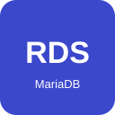
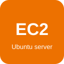

# AWS RDS Project: Student CRUD App on EC2 + RDS (MariaDB)

Deploy a 3-tier app (Apache frontend, Spring Boot backend, MariaDB on Amazon RDS)
on AWS. Application repo: https://github.com/IamPaimon/EasyCRUD

| RDS | EC2 | VPC |
|:---:|:---:|:---:|
|  |  |  |

## Architecture

```
Browser --80--> Apache2 (EC2) --8080--> Spring Boot API (EC2) --3306--> RDS MariaDB
```

## Contents

| File | What's inside |
|------|---------------|
| [docs/steps.txt](docs/steps.txt) | Full step-by-step guide |
| [docs/ports.txt](docs/ports.txt) | Ports to open and why |
| [docs/aws-services.txt](docs/aws-services.txt) | AWS services used |
| [logos/](logos) | Service badges (SVG) |

## Quick summary

1. Create an RDS MariaDB instance (private, Sandbox template).
2. Launch an EC2 Ubuntu instance, open ports 22, 80, 8080 (and 443 if using TLS).
3. Install `mysql-client`, `maven`, `openjdk-21-jdk`, then create the `student` database.
4. Clone EasyCRUD, set the RDS endpoint and credentials in `application.properties`, run `mvn clean package`.
5. Build the frontend (`npm run build`), copy `dist/*` to `/var/www/html/`.
6. Run `java -jar student-registration-backend-0.0.1-SNAPSHOT.jar`.

> **Security:** never commit your real DB password or endpoint. Use placeholders.
